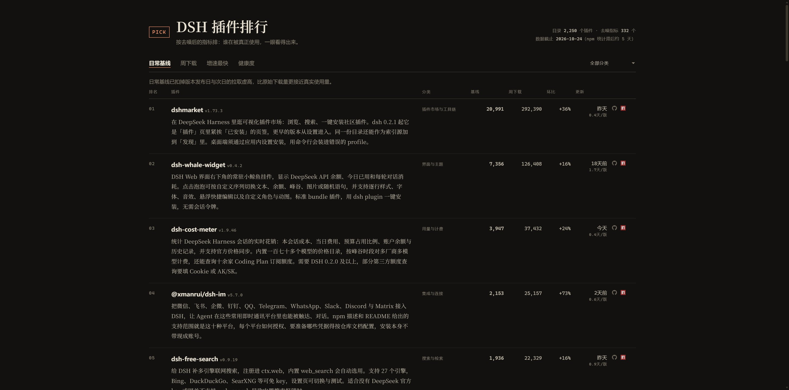

# dsh-pick 插件排行

**在线预览：<https://yanyoo2000.github.io/dsh-pick-preview/>**



给 [dsh-pick](https://www.npmjs.com/package/dsh-pick) 的插件目录做的一份**榜单**：按去噪后的指标排，每个插件带一段中文介绍。

只有一件事——排名。没有搜索、没有对比、没有监控。

## 为什么

翻 dsh-pick 的源码能看出一条线：

- 目录构建时把 npm 描述 `slice(0, 160)` **截断**了（2,250 个包里 946 个原本更长）
- 剩下的是 npm 那种一句话营销文案，其中 **1,357 个是纯英文**
- 排行榜**根本没有描述列**——只有名字、分类、数字

所以榜单上那行东西不是「没写介绍」，是「介绍只剩这么点」。这里把它补回来，并且只围绕榜单这一件事。

## 排什么

四个指标，点一下换一种看法：

| | |
|---|---|
| 日常基线 | 扣掉版本发布日与次日后的每日中位数，最接近真实使用量（默认） |
| 周下载 | 原始数字，含 CI、镜像、爬虫流量 |
| 增速最快 | 近 7 日环比 |
| 健康度 | 基线 40% + 增速 25% + 新鲜度 20% + 节奏 15% |

外加 13 个分类筛选。按基线 / 增速 / 健康度排时，只在有去噪指标的 332 个里排（去噪只算了周下载 Top 332）。

## 设计

印刷物，不是应用面板。

| | |
|---|---|
| 底 | 纸与墨，不是深浅灰 |
| 分隔 | 1px 细线，不画盒子 |
| 标题 | 衬线（宋体） |
| 介绍 | 衬线 13.5px / 1.8 行高 |
| 数字 | 等宽，右对齐 |
| 强调色 | 赭红 `#a8402b`，不是科技蓝 |
| 形状 | 没有圆角，没有阴影，没有 pill |

一行就是一条：序号 / 名字 / 介绍 / 分类 / 三个数字 / 更新 / 外链。暗色是同一张纸的另一种光线。

只做桌面，不做移动端适配。

## 介绍是怎么来的

1. 抓 npm registry 全部 2,250 个包的**完整元数据**（完整描述、关键词、发布时间）
2. 其中 **306 个包拿到 README**（那才是真正讲清"怎么用"的地方），本地提取摘要段
3. 分两档生成：
   - **精读**（306 个）：读 README 摘录 + 描述 → 一段话，含前提条件（要 API Key、限某平台等）
   - **概括**（1,944 个）：按完整描述 + 关键词 → 一句话说清做什么
4. 超过 180 字的长介绍再做一次压缩

## 数据口径

- 目录快照：**2026-10-24**（npm 统计约滞后 5 天）
- 覆盖：npm 上带 `dsh-plugin` 关键字的 **2,250** 个包
- 去噪指标只算了周下载 Top **332**
- 下载量含 CI、镜像、爬虫等非人类流量，**不等于用户数**

## 本地重建

```sh
node build.mjs      # 产出 index.html
```

`theme.css`（整套样式）和 `catalog.json`（精简目录）都在仓库里，不需要装 dsh-pick 也能构建。

## 文件

```
index.html         成品（单文件，离线可开，GitHub Pages 入口）
build.mjs          构建脚本
shell.html         页面骨架
panel.js           榜单渲染（四个指标 + 分类筛选）
theme.css          整套样式（纸/墨的印刷物世界）
intro.json         2,250 条中文介绍
catalog.json       精简后的插件目录
npm-meta.json      抓下来的 npm 原始元数据（复现 intro.json 用）
fetch-meta.mjs     抓 npm 元数据
prep.mjs           README 压摘要段，生成待生成清单
split.mjs          拆成小批次
（生成介绍这一步是逐批交给模型做的，产物就是 intro.json）
merge.mjs          合并各批结果并校验覆盖率
```

## 说明

不是 dsh-pick 的官方页面。介绍由各插件自己的 npm 描述和 README 整理而成，**不是官方文档**，具体用法以插件仓库为准。
