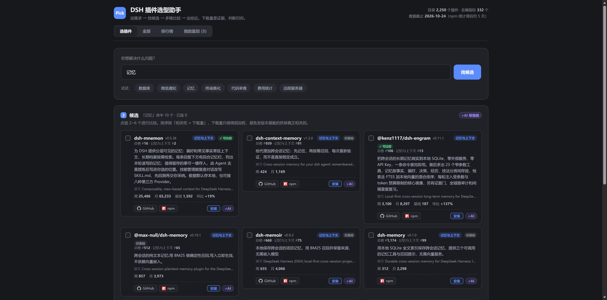
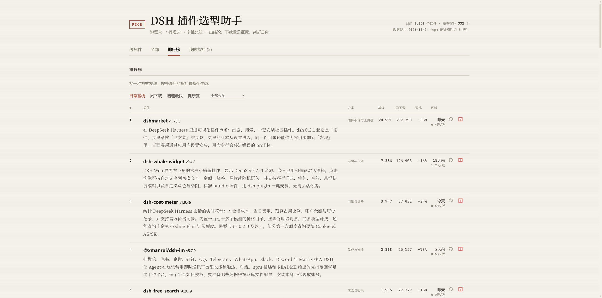
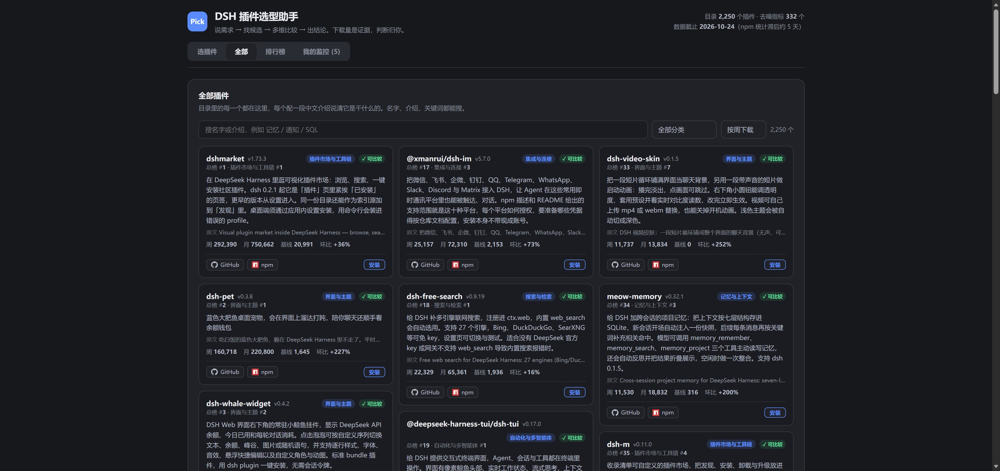

# dsh-pick 插件介绍版面板

**在线预览：<https://yanyoo2000.github.io/dsh-pick-preview/>**



给 [dsh-pick](https://www.npmjs.com/package/dsh-pick) 的选插件面板补上了一层「介绍」——
原版只列出插件名和几个下载数字，看完还是不知道它是干什么的。

## 为什么做这个

翻 dsh-pick 的源码能看出一条线：

- 目录构建时把 npm 描述 `slice(0, 160)` **截断**了（2,250 个包里 946 个原本更长）
- 剩下的是 npm 那种一句话营销文案，其中 **1,357 个是纯英文**
- 排行榜和监控页**根本没有描述列**——只有名字、分类、数字

所以卡片上那两行英文不是「没写介绍」，是「介绍只剩这么点」。这个页面就是想把它补回来。

## 比原版多了什么

| | 原版 | 这里 |
|---|---|---|
| 每个插件的介绍 | 两行英文截断 | 一段中文，讲用途 + 装了能做什么 + 有什么前提 |
| 排行榜 | 名字 + 数字 | 名字下面带完整介绍 |
| 我的监控 | 名字 + 数字 | 同上 |
| 全部插件 | 只能看 Top 40 | 「全部」页签，2,250 个都能翻，带搜索/分类/排序/分页 |
| 搜索 | 只匹配包名、关键词、描述 | 介绍文本也参与匹配 |

排行榜每行名字下面直接带介绍，不用点进去：



「全部」页签，2,250 个都能翻，带搜索 / 分类 / 排序 / 分页：



## 介绍是怎么来的

1. 抓 npm registry 全部 2,250 个包的**完整元数据**（完整描述、关键词、发布时间）
2. 其中 **306 个包拿到 README**（那才是真正讲清"怎么用"的地方），本地提取摘要段
3. 分两档生成：
   - **精读**（306 个）：读 README 摘录 + 描述 → 一段话，含前提条件（要 API Key、限某平台等）
   - **概括**（1,944 个）：按完整描述 + 关键词 → 一句话说清做什么
4. 超过 180 字的长介绍再做一次压缩，保证卡片上一屏能看完

举例：

> **dshmarket** — 在 DeepSeek Harness 里逛可视化插件市场：浏览、搜索、一键安装社区插件。dsh 0.2.1 起它是「插件」页里紧挨「已安装」的页签，更早的版本从设置进入。桌面端须通过应用内设置安装，用命令行会装进错误的 profile。

> **dsh-bossintroduce** — 在 Boss 直聘求职者侧浏览岗位，为每条 JD 生成专属自我介绍并发给 HR。

## 数据口径

- 目录快照：**2026-10-24**（npm 统计约滞后 5 天）
- 覆盖：npm 上带 `dsh-plugin` 关键字的 **2,250** 个包
- 去噪指标（日常基线 / 环比 / 版本节奏 / 健康度）只算了周下载 Top **332**
- 下载量含 CI、镜像、爬虫等非人类流量，**不等于用户数**

## 本地重建

```sh
node build.mjs      # 产出 index.html
```

`panel.css`（原版样式）和 `catalog.json`（精简目录）都在仓库里，所以不需要装 dsh-pick 也能构建。

## 文件

```
index.html         成品（单文件，离线可开，GitHub Pages 入口）
build.mjs          构建脚本
shell.html         页面骨架
panel.js           面板逻辑（渲染照原版复刻）
panel.css          原版样式（从 dsh-pick 的 web/panel.html 提取）
extra.css          本页新增：介绍区、全部插件页
intro.json         2,250 条中文介绍
catalog.json       精简后的插件目录
npm-meta.json      抓下来的 npm 原始元数据（复现 intro.json 用）
fetch-meta.mjs     抓 npm 元数据
prep.mjs           README 压摘要段，生成待生成清单
split.mjs          拆成小批次
（生成介绍这一步是逐批交给模型做的，产物就是 intro.json）
merge.mjs          合并各批结果并校验覆盖率
```

## 说明

这不是 dsh-pick 的官方页面，是它面板的界面复刻加一层介绍。
介绍由各插件自己的 npm 描述和 README 整理而成，**不是官方文档**，具体用法以插件仓库为准。

原版面板的「+AI」和「安装」依赖 DSH 宿主，这个静态版里只做本地提示（复制提示词 / 给出等效命令）。
